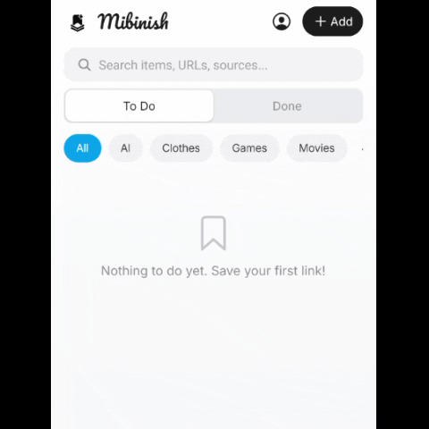
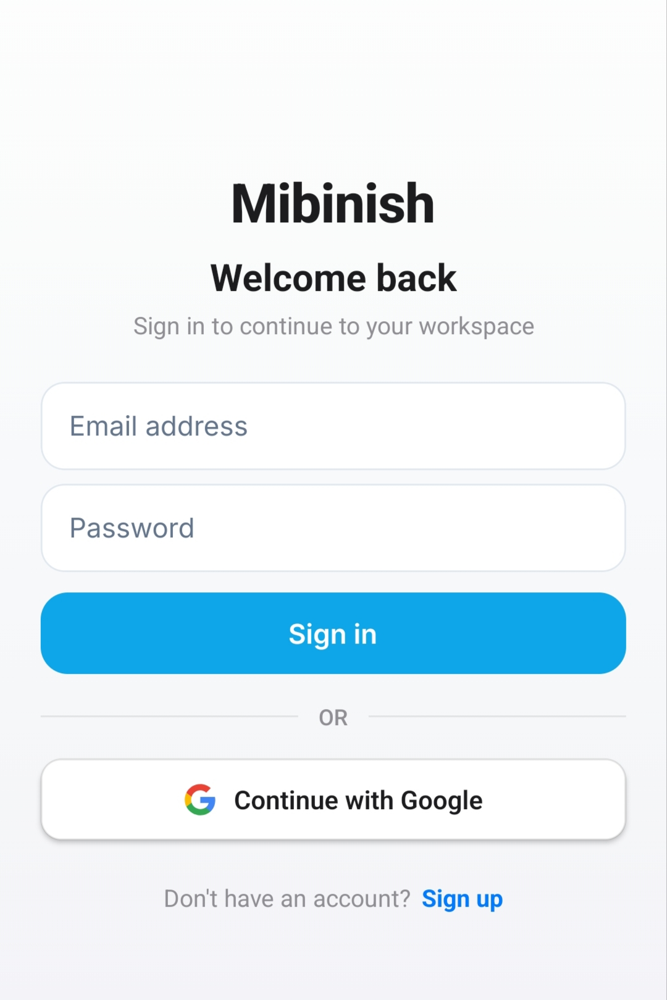
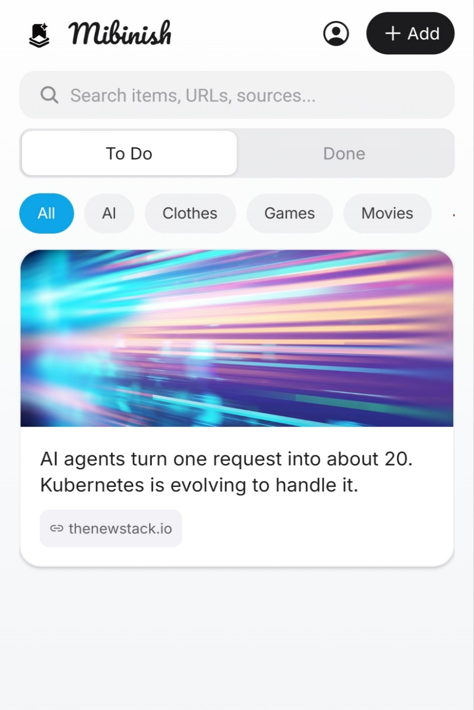
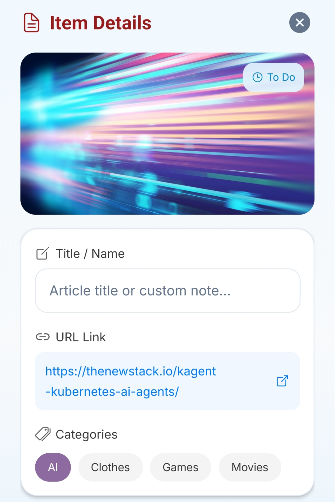
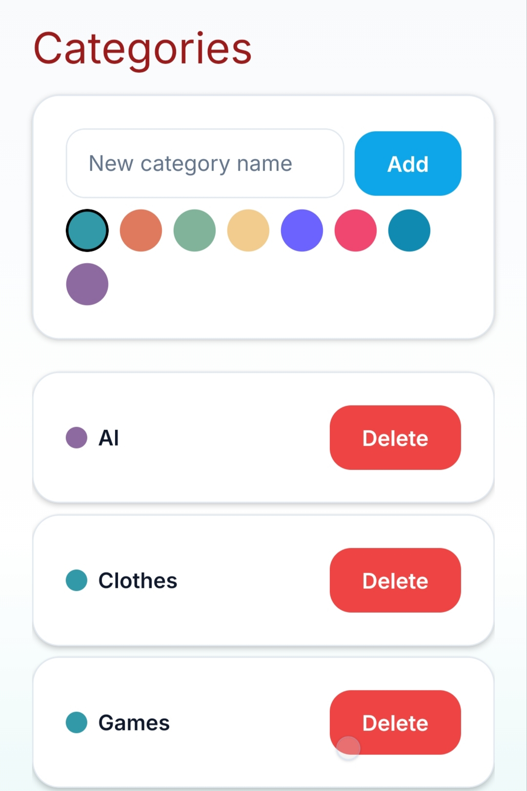
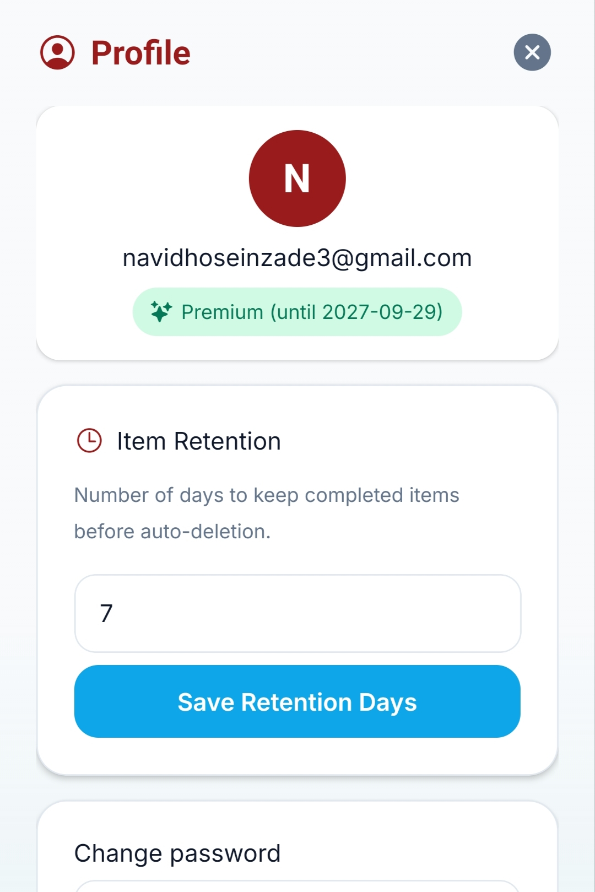
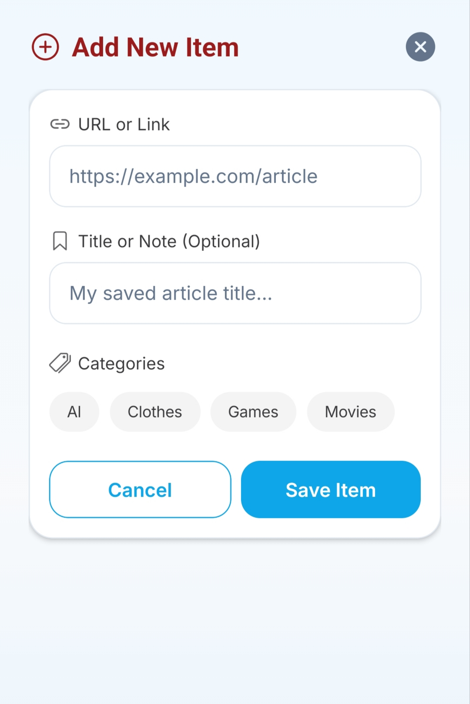
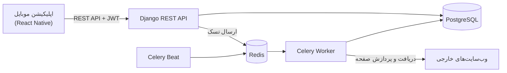

# Mibinish (می‌بینیش)

اپلیکیشن اندرویدی برای ذخیره‌سازی لینک‌ها و مدیریت محتوایی که قرار است بعداً مطالعه، تماشا یا بررسی شود.

<p align="center">
  
</p>

می‌بینیش امکان ذخیره‌سازی محتوا از مرورگرها و سایر اپلیکیشن‌ها را از طریق منوی Share اندروید فراهم می‌کند. پس از دریافت لینک، بک‌اند به‌صورت غیرهم‌زمان اطلاعاتی مانند عنوان، توضیحات و تصویر پیش‌نمایش صفحه را استخراج می‌کند. آیتم‌های ذخیره‌شده را می‌توان دسته‌بندی، جستجو و فیلتر کرد و پس از مشاهده، وضعیت آن‌ها را به انجام‌شده تغییر داد. آیتم‌های انجام‌شده پس از پایان مدت نگهداری تعیین‌شده، به‌صورت خودکار حذف می‌شوند.

این پروژه با هدف یادگیری و فان توسعه داده شده است. معماری آن شامل یک REST API مبتنی بر Django و یک اپلیکیشن موبایل مبتنی بر React Native و Expo است.

**فرانت‌اند پروژه با کمک ابزارهای هوش مصنوعی توسعه داده شده است.** تمرکز فنی پروژه، علاوه بر توسعه اپلیکیشن موبایل، بر طراحی بک‌اند، پردازش غیرهم‌زمان، ملاحظات امنیتی و تست خودکار قرار دارد.

## تصاویر اپلیکیشن

<p align="center">
  
  
  
</p>
<p align="center">
  
  
  
</p>

## امکانات

- **ذخیره‌سازی لینک:** دریافت لینک از طریق منوی Share اندروید یا افزودن دستی آن.
- **استخراج خودکار اطلاعات:** دریافت عنوان، توضیحات، تصویر پیش‌نمایش و اطلاعات منبع صفحه به‌صورت غیرهم‌زمان.
- **مدیریت و دسته‌بندی:** ایجاد دسته‌بندی با رنگ دلخواه، جستجوی آیتم‌ها و فیلتر بر اساس دسته یا وضعیت انجام.
- **مدیریت وضعیت آیتم‌ها:** پشتیبانی از وضعیت‌های To Do و Done و حذف خودکار آیتم‌های انجام‌شده پس از پایان دوره نگهداری.
- **احراز هویت:** ورود با ایمیل و رمز عبور یا حساب Google.
- **طرح‌های رایگان و پریمیوم:** اعمال محدودیت تعداد آیتم برای کاربران رایگان و امکان تنظیم مدت نگهداری آیتم‌ها برای کاربران پریمیوم.

## فناوری‌های استفاده‌شده

**بک‌اند**
- Python و Django
- Django REST Framework
- SimpleJWT برای احراز هویت مبتنی بر JWT
- django-filter برای فیلترکردن API
- drf-spectacular برای مستندسازی OpenAPI و Swagger
- PostgreSQL برای ذخیره‌سازی داده‌ها
- Celery و Redis برای پردازش غیرهم‌زمان و اجرای وظایف زمان‌بندی‌شده
- Unfold برای رابط کاربری پنل مدیریت Django
- Sentry برای پایش و گزارش خطا به‌صورت اختیاری

**اپلیکیشن موبایل**
- React Native و Expo
- Expo Router و TypeScript
- Axios برای ارتباط با API
- expo-secure-store برای ذخیره‌سازی امن داده‌های محلی
- expo-share-intent برای دریافت محتوای اشتراک‌گذاری‌شده
- react-native-google-signin برای ورود با حساب Google

فرانت‌اند با استفاده از ابزارهای هوش مصنوعی توسعه یافته است.

## معماری



پس از ارسال لینک، API آیتم را در پایگاه داده ایجاد می‌کند و وظیفه استخراج اطلاعات آن را در صف Celery قرار می‌دهد. پاسخ API منتظر پایان پردازش نمی‌ماند. یک Celery Worker صفحه مقصد را دریافت می‌کند، اطلاعات قابل استخراج را پردازش می‌کند و نتیجه را در رکورد مربوط به همان آیتم ذخیره می‌کند.

اپلیکیشن موبایل تا زمان پایان پردازش، وضعیت آیتم را به‌صورت دوره‌ای به‌روزرسانی می‌کند.

همچنین Celery Beat وظایف زمان‌بندی‌شده‌ای مانند بازگرداندن اشتراک‌های پریمیوم منقضی‌شده به طرح رایگان و حذف آیتم‌های انجام‌شده پس از پایان مدت نگهداری را اجرا می‌کند.

## نکات فنی

### احراز هویت و مدیریت توکن

احراز هویت مبتنی بر JWT با استفاده از SimpleJWT پیاده‌سازی شده است. این سازوکار شامل چرخش توکن‌های Refresh و امکان مسدودسازی توکن‌ها از طریق Blacklist است.

### مقابله با SSRF
<div dir="rtl">
در خط لوله استخراج اطلاعات، سازوکارهایی برای کاهش خطر حملات Server-Side Request Forgery (SSRF) در نظر گرفته شده است. پیش از ارسال درخواست و دنبال‌کردن Redirectها، آدرس مقصد Resolve و اعتبارسنجی می‌شود تا از دسترسی به آدرس‌های IP داخلی، از جمله Loopback، Private و Link-local، جلوگیری شود. همچنین محدودیت‌هایی برای زمان انتظار درخواست، حجم پاسخ و تعداد Redirectها اعمال شده است.
</div>

### جلوگیری از Race Condition

هر آیتم دارای فیلد `extraction_version` است. اگر URL آیتم در حین اجرای وظیفه استخراج تغییر کند، نسخه وظیفه با نسخه فعلی آیتم بررسی می‌شود. در نتیجه، خروجی وظایف قدیمی کنار گذاشته می‌شود تا اطلاعات منسوخ، داده‌های جدیدتر را بازنویسی نکنند.

### مدیریت خطا در پردازش غیرهم‌زمان

در صورت در دسترس نبودن Celery Broker، ایجاد آیتم صرفاً به دلیل ناموفق‌بودن ارسال وظیفه شکست نمی‌خورد. در عوض، وضعیت استخراج به `failed` تغییر می‌کند و خود آیتم در پایگاه داده باقی می‌ماند.

### تست خودکار

بک‌اند دارای تست‌های واحد و یکپارچه برای مدل‌ها، سریالایزرها، endpointهای API، خط لوله استخراج اطلاعات، وظایف پس‌زمینه و سناریوهای مرتبط با Race Condition است.

## راه‌اندازی پروژه

### پیش‌نیازها

- Python (نسخه سازگار با وابستگی‌های پروژه؛ نسخه مورد استفاده در توسعه: 3.14)
- PostgreSQL
- Redis؛ استفاده از Docker یکی از روش‌های ساده راه‌اندازی است.
- Node.js و npm
- دستگاه اندرویدی
- حساب Expo و ابزار EAS CLI برای ساخت Development Build

### ۱. راه‌اندازی بک‌اند

از ریشه مخزن:

```bash
cd backend

python -m venv .venv
source .venv/bin/activate

pip install -r requirements.txt

cp .env.base.example .env.base
cp .env.development.example .env.development
```

فایل‌های محیطی را مطابق تنظیمات محلی تکمیل کنید. متغیرهای موردنیاز در فایل‌های نمونه مشخص شده‌اند.

ایجاد کاربر و پایگاه داده PostgreSQL:

```bash
sudo -u postgres psql -c \
  "CREATE USER mibinish WITH PASSWORD 'password' CREATEDB;"

sudo -u postgres psql -c \
  "CREATE DATABASE mibinish OWNER mibinish;"
```

مقادیر بالا صرفا نمونه‌ای برای محیط توسعه محلی هستند و در صورت نیاز باید متناسب با تنظیمات محیط تغییر کنند.

اجرای Migrationها و ایجاد کاربر مدیر:

```bash
python manage.py migrate
python manage.py createsuperuser
```

اجرای سرور توسعه:

```bash
python manage.py runserver 0.0.0.0:8000
```

API از مسیر `http://localhost:8000/api/v1/` در دسترس خواهد بود.

در صورت فعال‌بودن `DJANGO_DEBUG=True`، مستندات Swagger از مسیر `/api/docs/` قابل دسترسی است. پنل مدیریت Django نیز در مسیر تعیین‌شده توسط `DJANGO_ADMIN_URL` قرار دارد که مقدار پیش‌فرض آن `admin/` است.

### ۲. راه‌اندازی Redis و Celery

اجرای Redis با Docker:

```bash
docker run -d \
  --name mibinish-redis \
  -p 127.0.0.1:6379:6379 \
  redis:7-alpine
```

پس از فعال‌کردن محیط مجازی بک‌اند، در یک ترمینال Celery Worker را اجرا کنید:

```bash
celery -A config worker -l info
```

سپس در ترمینالی جداگانه Celery Beat را اجرا کنید:

```bash
celery -A config beat -l info
```

اجرای Worker برای پردازش وظایف استخراج اطلاعات ضروری است. بدون آن، وظایف موجود در صف پردازش نخواهند شد. Celery Beat نیز برای اجرای وظایف دوره‌ای، از جمله مدیریت انقضای اشتراک‌ها و حذف آیتم‌های قدیمی، موردنیاز است.

### ۳. راه‌اندازی اپلیکیشن موبایل

اپلیکیشن برای ورود با Google و دریافت محتوای اشتراک‌گذاری‌شده از قابلیت‌های Native اندروید استفاده می‌کند. این قابلیت‌ها در Expo Go به‌طور کامل پشتیبانی نمی‌شوند؛ بنابراین اجرای آن‌ها به یک Development Build نیاز دارد.

از ریشه مخزن:

```bash
cd frontend

npm install
cp .env.example .env
```

متغیرهای محیطی، از جمله آدرس API و تنظیمات موردنیاز برای احراز هویت Google، را مطابق فایل نمونه تنظیم کنید.

نصب EAS CLI و ورود به حساب Expo:

```bash
npm install -g eas-cli
eas login
```

ساخت Development Build برای اندروید:

```bash
eas build --platform android --profile development
```

پس از نصب خروجی Build روی دستگاه اندرویدی، سرور توسعه را اجرا کنید:

```bash
npx expo start --dev-client
```

آدرس API باید از دستگاه قابل دسترسی باشد. هنگام استفاده از گوشی واقعی، `localhost` به خود گوشی اشاره می‌کند، نه کامپیوتری که سرور بک‌اند روی آن اجرا شده است.

### ۴. اجرای تست‌ها

پس از فعال‌کردن محیط مجازی بک‌اند:

```bash
cd backend
DJANGO_SETTINGS_MODULE=config.settings.test python manage.py test
```

## ساختار پروژه

```text
mibinish/
├── backend/
│   ├── apps/
│   │   ├── users/          # احراز هویت، پروفایل و اشتراک‌ها
│   │   ├── saved_items/    # آیتم‌ها، دسته‌ها و خط لوله استخراج
│   │   └── core/           # قابلیت‌های مشترک بک‌اند
│   ├── config/
│   │   └── settings/       # تنظیمات base، development، production و test
│   └── tests/              # تست‌های یکپارچه
├── frontend/               # اپلیکیشن موبایل مبتنی بر Expo
│   └── src/
│       ├── app/
│       ├── components/
│       └── api/
└── docs/
    └── screenshots/        # تصاویر و ویدئوی نمایشی اپلیکیشن
```

## وضعیت فعلی پروژه و محدودیت‌ها

- **استقرار:** تنظیمات مرتبط با محیط Production، شامل تنظیمات امنیتی HTTPS، محدودسازی نرخ درخواست‌ها، لاگ‌گیری، Health Check و اتصال اختیاری به Sentry، پیاده‌سازی شده‌اند؛ اما پروژه هنوز در محیط عملیاتی مستقر نشده است.
- **پرداخت:** پرداخت واقعی پیاده‌سازی نشده و اشتراک‌های پریمیوم در حال حاضر به‌صورت دستی از طریق پنل مدیریت Django فعال می‌شوند.
- **پلتفرم‌ها:** اپلیکیشن فعلاً برای اندروید توسعه داده شده است و پشتیبانی از iOS پیاده‌سازی یا تأیید نشده است.

"می‌بینیش" یک پروژه آموزشی و نمونه‌کار است که با هدف فان و آشنایی عملی با توسعه اپلیکیشن موبایل، طراحی REST API، پردازش غیرهم‌زمان، ملاحظات امنیتی و تست خودکار بک‌اند توسعه داده شده است.